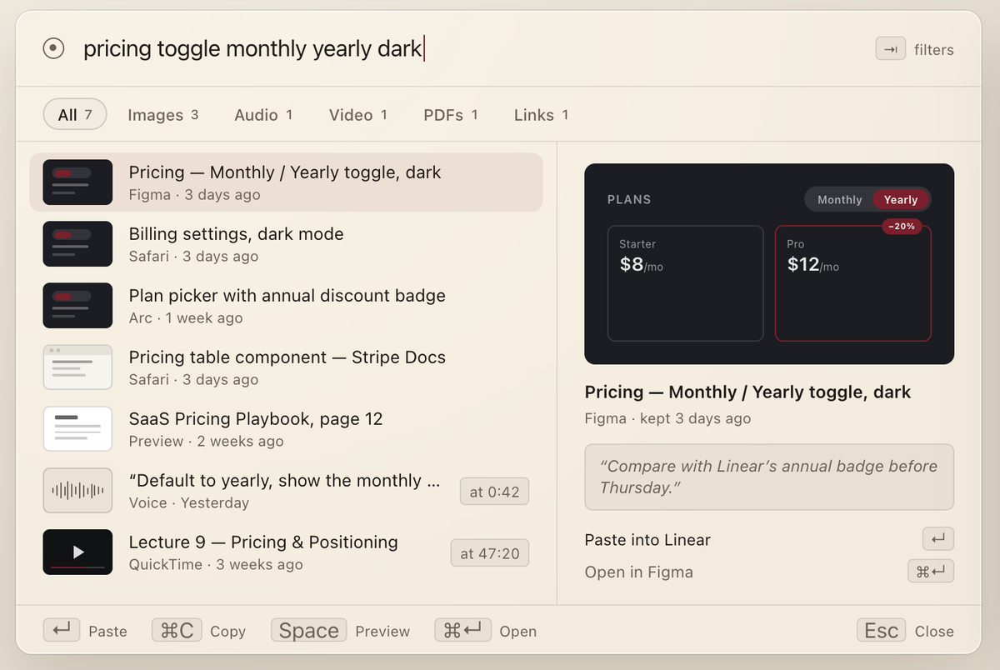
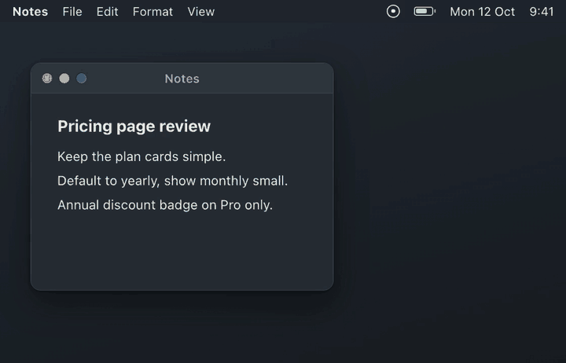
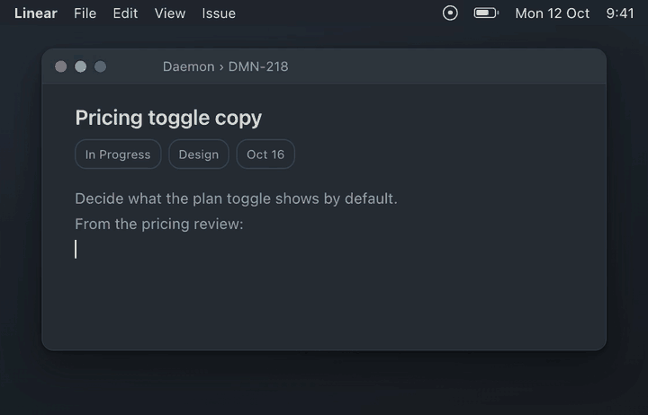
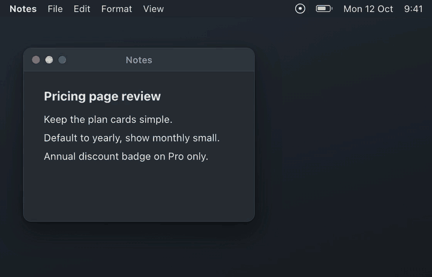
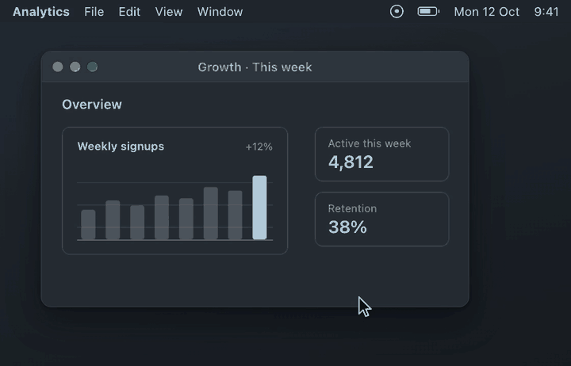
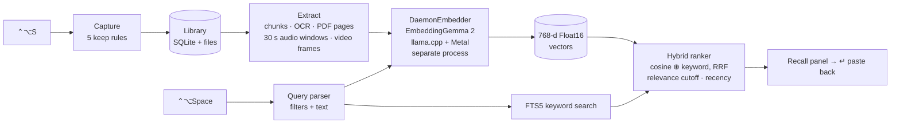

<div align="center">

<picture>
  <source media="(prefers-color-scheme: dark)" srcset="docs/media/hero-dark.png">
  
</picture>

# Daemon

**Your other self remembers.**

A free, open-source memory for your Mac. Keep anything with one key, recall it by meaning with another.
Everything runs on your Mac, with no account and no cloud.

[**Download for Mac**](https://github.com/iamartyaa/daemon/releases/latest) · [Build from source](#build-from-source) · [How it works](#how-it-works) · [Extend it](#extend-it)


[](LICENSE)

</div>

<table>
<tr>
<td width="50%"><br><sub><b>⌃⌥S keeps</b> whatever is in front of you</sub></td>
<td width="50%"><br><sub><b>⌃⌥Space recalls</b> it by meaning, <b>↵</b> pastes it back</sub></td>
</tr>
<tr>
<td><br><sub><b>Hold ⌃⌥S</b> to speak a voice note</sub></td>
<td><br><sub><b>Nothing selected?</b> Drag over the part you want</sub></td>
</tr>
</table>

## Why Daemon

Useful things end up everywhere: screenshots on the Desktop, a line in a chat, a voice memo, a tab you meant to come
back to. Daemon keeps them in one place and finds them again from a description like *"the blue pricing table"* or
*"the voice note about the caching idea"*, even when you never named the thing.

- **One key, no decisions.** `⌃⌥S` does the obvious thing for what's in front of you (see [the five rules](#the-five-keep-rules)).
- **Search by meaning, across everything.** Text, screenshots (and the words inside them), images, PDFs including
  scanned pages, Word and text files, audio, voice notes, video and links all live in one search space. A typed query
  finds a screenshot or a spoken sentence.
- **Instant.** Results on every keystroke in about 11 ms. `↵` pastes the result straight back where your cursor was.
- **Private.** Nothing leaves your Mac. One open model ([EmbeddingGemma 2](https://huggingface.co/google/embeddinggemma-2))
  runs locally on llama.cpp with Metal. No account, no analytics, no telemetry.
- **Light.** At rest: 0% CPU and ~21 MB for the app. The model process unloads its heavy parts when idle.
- **Free and MIT-licensed.** Fork it, ship it, build on it.

## Install

### Download

1. Get **Daemon.dmg** from the [latest release](https://github.com/iamartyaa/daemon/releases/latest) and drag Daemon to Applications.
2. Open it. Release builds aren't notarized yet, so macOS will say it can't verify the developer the first time:
   - **macOS 15 and later:** System Settings → Privacy & Security → scroll down → **Open Anyway**.
   - **macOS 14:** right-click Daemon in Applications → **Open** → **Open**.
   - Or from Terminal: `xattr -dr com.apple.quarantine /Applications/Daemon.app`
3. On first launch Daemon downloads the model (~865 MB, once), shows a one-minute tour and asks for **Accessibility**.

Requires macOS 14 or later on Apple Silicon (M1 or newer).

### Build from source

You need Xcode 26 or later.

```bash
git clone https://github.com/iamartyaa/daemon.git
cd daemon
make install    # release build → ~/Applications/Daemon.app, then opens it
```

| Command | What it does |
|---|---|
| `make build` | Debug build of every target |
| `make test` | Unit, integration and UI tests (model-dependent tests skip until the model is downloaded) |
| `make app` | Release `build/Daemon.app` |
| `make install` | `make app`, install to `~/Applications`, register with Spotlight and open |
| `make dmg` | `build/Daemon.dmg`; notarized when `DAEMON_SIGN_IDENTITY` and `DAEMON_NOTARY_PROFILE` are set |

> [!TIP]
> `scripts/bundle.sh` signs with your **Apple Development** certificate if one is in your keychain (a free Apple ID in
> Xcode is enough). Use one: macOS ties privacy permissions to the signature, so ad-hoc builds lose their
> Accessibility grant every time you rebuild.

## Use

| Shortcut | Action |
|---|---|
| `⌃⌥S` | Keep what's in front of you |
| Hold `⌃⌥S` | Speak a voice note; let go to keep it |
| `⌃⌥Space` | Open Recall |
| `↵` | Paste the result into the app you were in |
| `⌘C` / `⌘↵` / `Space` | Copy · open in its app · Quick Look |
| `⌘V` in Recall | Keep whatever is on the clipboard |
| `⇥` on a "Kept" toast | Add a note to what you just kept |

Both shortcuts can be changed in Settings. You can also drop files on the menu bar icon.

### The five keep rules

`⌃⌥S` checks these in order and does the first that applies:

1. **Held down** → a voice note
2. **Text selected** → the text, with the app and window it came from
3. **Files selected in Finder** → copies of the files (originals can move or disappear; files over 500 MB are kept by reference)
4. **A browser with nothing selected** → the page URL and title, plus a screenshot
5. **Anything else** → drag over a region to keep a screenshot

### Recall syntax

Just describe it. Filters can go anywhere in the query and combine:

| Filter | Examples |
|---|---|
| Source app | `from:safari`, `from:figma` |
| Kind | `images`, `screenshots`, `voice`, `audio`, `video`, `pdf`, `links`, `type:text` |
| Time | `today`, `yesterday`, `this week`, `last month`, `in march`, `3 days ago` |

`from:arc last week pricing table` → links and screenshots from Arc, last week, about pricing tables.

## Privacy

- **Nothing leaves your Mac.** The only network requests are the one-time model download from Hugging Face and an
  optional update check (off in Settings).
- **Daemon keeps only what you hand it.** No background screen recording, no disk crawling, no clipboard history.
- **Permissions are asked once, when first needed:** Accessibility (read the selection, paste back) at onboarding;
  Screen Recording, Microphone and Automation (browser URL, Finder selection) the first time you use those features.
- **Password managers are excluded** by default (Passwords, Keychain Access, 1Password, Bitwarden, …). Add any app in Settings.
- **Retention:** kept items are deleted automatically after 7, 30 or 90 days (default 30), files and index included.
  Export everything to a folder at any time.

| What | Where |
|---|---|
| Library (SQLite, vectors, keyword index) | `~/Library/Application Support/Daemon/Library/library.sqlite` |
| Kept files (deduplicated by SHA-256) and thumbnails | `~/Library/Application Support/Daemon/Library/files/`, `thumbnails/` |
| Model | `~/Library/Application Support/Daemon/models/` |

To uninstall completely, quit Daemon, delete the app, then `rm -r ~/Library/Application\ Support/Daemon`.

## How it works



- **One model, one space.** EmbeddingGemma 2 maps text, images and audio into the same 768-dimension space, so text
  queries match pictures and speech directly. No captioning or transcription step to go wrong.
- **The model lives in its own process.** `DaemonEmbedder` talks JSON lines over stdin/stdout. A crash or memory spike
  never takes the UI down, and the process restarts after two idle minutes to release the image/audio encoders.
- **Search is two-phase.** Keyword hits come back within a few ms of each keystroke, meaning hits are merged in when the
  query embedding is ready, and stale answers are dropped. Vector search is brute-force cosine over Float16 with
  Accelerate (~12 ms for 100k segments): no ANN index to build, tune or corrupt.
- **Capture never blocks.** Selection and browser reads start on key-down off the main thread; toasts are Core
  Animation layers, so a keep costs 2–4% of a core.

Measurements, method and per-operation memory/CPU are in [`docs/qa-performance-report.md`](docs/qa-performance-report.md).

## Project layout

| Path | What's there |
|---|---|
| [`Sources/DaemonCore/Contracts.swift`](Sources/DaemonCore/Contracts.swift) | The shared types and protocols every module talks through: `Item`, `Segment`, `Capture`, `Embedder`, `CaptureSink`, `RecallDataSource`. **Start here.** |
| `Sources/DaemonCore/Library` | GRDB/SQLite schema, content-addressed file store, export |
| `Sources/DaemonCore/Extract` | Item → segments: text chunking, PDF, OCR, audio/video windows |
| `Sources/DaemonCore/Search` | Query parser, Float16 vector index, hybrid ranker |
| `Sources/DaemonCore/Embedding` | `EmbedderClient`, which runs and supervises the model process |
| `Sources/DaemonCore/App` | `Engine` (the façade the app uses), indexing pipeline, `Perf` signposts |
| `Sources/DaemonCore/Retention`, `ModelDownload`, `Stats` | Auto-delete, resumable model download, local usage counts |
| `Sources/DaemonEmbedder` | The model process: llama.cpp + mtmd |
| `Sources/DaemonCapture` | Hotkeys, keep rules, selection/Finder/browser readers, region capture, voice, paste-back, permissions |
| `Sources/DaemonUI` | Recall panel, toasts, menu bar, onboarding, Settings, and [`Theme.swift`](Sources/DaemonUI/Theme.swift) (all colors, type, radii, timings) |
| `Sources/Daemon` | App entry point; `AppController` wires the modules together |
| `Onboarding/remotion` | The onboarding clips, written as [Remotion](https://www.remotion.dev) code (`npm ci && npm run render`) |
| `Sources/EmbedSpike`, `Spikes/MLXSpike` | Embedder benchmark (`make spike`) and the MLX-vs-llama.cpp comparison |
| `design/screenshots` | Design reference: **Ivory** (light) and **Smoked** (dark) |

## Extend it

The modules only meet through the protocols in `Contracts.swift`, so most changes stay inside one folder.

<details>
<summary><b>Index a new file type</b></summary>

`Extractor.segments(for:fileURL:workDir:)` in [`Extract/Extractor.swift`](Sources/DaemonCore/Extract/Extractor.swift)
turns a kept item into `SegmentDraft`s, each with the text to keyword-index and an `EmbedInput` (`.document`, `.image`
or `.audio`) to embed. Add a branch for your `UTType` and return drafts; the pipeline, storage and search pick them up.
Add a fixture-based test in `Tests/DaemonCoreTests/ExtractTests.swift`.
</details>

<details>
<summary><b>Change what ⌃⌥S does in an app</b></summary>

`ContextRules.decide(_:)` in [`DaemonCapture/ContextRules.swift`](Sources/DaemonCapture/ContextRules.swift) is a pure
function from a `ContextSnapshot` to a `KeepAction`. Browsers that expose their URL over AppleScript are listed by
bundle ID in the same file, as are the default excluded apps.
</details>

<details>
<summary><b>Swap the model</b></summary>

Anything that conforms to `Embedder` (`embed(_ input: EmbedInput) async throws -> [Float]`) can replace the default.
For another GGUF model on llama.cpp, change the files in
[`ModelDownload/ModelManifest.swift`](Sources/DaemonCore/ModelDownload/ModelManifest.swift) and the prompt prefixes in
`DaemonEmbedder/main.swift`. Vectors record their `modelVersion`, so a new model means re-embedding the library.
</details>

<details>
<summary><b>Add a Recall filter</b></summary>

[`Search/QueryParser.swift`](Sources/DaemonCore/Search/QueryParser.swift) turns words into `SearchFilters`; add a
prefix or phrase there and its case in `SearchQueryParserTests`.
</details>

<details>
<summary><b>Restyle it</b></summary>

Every color, font, radius and animation timing comes from [`Theme.swift`](Sources/DaemonUI/Theme.swift), with an
Ivory and a Smoked value for each color. Views don't hardcode any of them.
</details>

<details>
<summary><b>Profile it</b></summary>

Hot paths are wrapped in `os_signpost` intervals (`Perf.begin` / `Perf.end`); open Instruments → Points of Interest.
Benchmarks: `DAEMON_PERF=1 swift test --filter RecallPerfTests` and
`DAEMON_BENCH=1 swift test -c release -Xswiftc -enable-testing --filter "ToastPerfTests|PerfBenchmarks|OCRTests"`.
</details>

## Contributing

Issues and pull requests are welcome.

1. Fork, branch from `main` (`feat/…`, `fix/…`), keep the change focused.
2. `make test` passes. UI changes: a before/after screenshot in both Ivory and Smoked.
3. Match the code around you. In UI copy the verbs are **Keep / Kept** and **Recall**, never "save" or "search".
4. Anything that touches capture or storage keeps the privacy promise: nothing leaves the Mac, nothing is kept that
   the user didn't hand over.

Good first areas: more browsers in `ContextRules`, more file types in `Extractor`, translations, and measurements on
an 8 GB M1.

## FAQ

<details>
<summary><b>Does it need the internet?</b></summary>

Only once, to download the model. After that it works fully offline.
</details>

<details>
<summary><b>How much disk and memory does it use?</b></summary>

The model is ~865 MB on disk. At rest the app uses ~21 MB and the model process ~160 MB. Keeping an image or audio
loads the media encoders (~1–2 GB) until two idle minutes pass. Kept items take what the files take, deduplicated; each
vector is 1.5 KB.
</details>

<details>
<summary><b>Intel Macs?</b></summary>

Not supported. The model runs on the Apple Silicon GPU through Metal.
</details>

<details>
<summary><b>Why doesn't it ask for Full Disk Access or record my screen?</b></summary>

It doesn't need to. Daemon only sees what you hand it with `⌃⌥S`, a drop or `⌘V`.
</details>

## Acknowledgements

Daemon stands on [EmbeddingGemma 2](https://huggingface.co/google/embeddinggemma-2) by Google (Apache 2.0, downloaded
at first run from [ggml-org/embeddinggemma-2-GGUF](https://huggingface.co/ggml-org/embeddinggemma-2-GGUF)),
[llama.cpp](https://github.com/ggml-org/llama.cpp) (MIT), [GRDB.swift](https://github.com/groue/GRDB.swift) (MIT),
[KeyboardShortcuts](https://github.com/sindresorhus/KeyboardShortcuts) (MIT) and
[Sparkle](https://github.com/sparkle-project/Sparkle) (MIT). The onboarding clips are made with
[Remotion](https://www.remotion.dev), which has [its own license](https://www.remotion.dev/license) for rendering.

## License

[MIT](LICENSE) © 2026 Amartya Yadav
