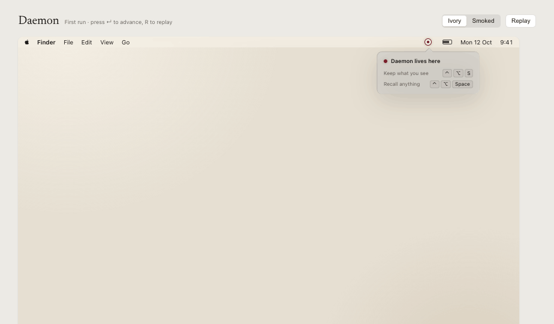
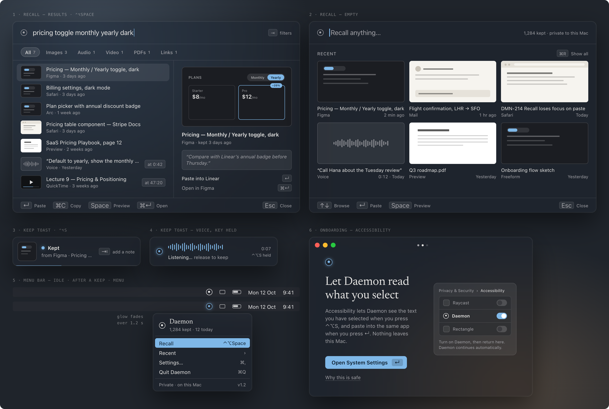

<div align="center">



# Daemon for Mac

**Your other self remembers.**

Keep anything with one key. Recall it by meaning with another. Nothing leaves your Mac.

`⌃⌥S` keep  ·  `⌃⌥Space` recall  ·  100% on-device  ·  no account  ·  macOS 14+ on Apple Silicon

</div>

---



## What it does

Useful things are scattered: screenshots on the Desktop, snippets in chats, voice notes, references in forty tabs.
Daemon is a menu bar app that acts as a second memory.

- **Keep in under a second, from any app.** One hotkey does the obvious thing for what's in front of you:
  1. hold it → a **voice note**
  2. text selected → the **text**
  3. files selected in Finder → **copies of the files**
  4. a browser with nothing selected → the **page URL and title**, plus a screenshot
  5. anything else → a **region screenshot**

  Also: drop files on the menu bar icon, or press `⌘V` in Recall to keep the clipboard.
- **Recall by describing it.** "the blue pricing table", "the voice note about the caching idea",
  `from:safari last week flight`. Results update as you type; `↵` pastes the item straight back into the app you were in.
- **Everything is searchable by meaning:** text, images and screenshots (plus the text inside them), PDFs (scanned pages
  too), Word and text files, audio and voice notes, video, and links.

## How it works

```
 ⌃⌥S ─▶ Capture ─▶ Library ─▶ Extract ─▶ DaemonEmbedder ─▶ vectors ─┐
        (rules)    (SQLite +   (chunks, OCR,  (EmbeddingGemma 2 on     │
                    files)      audio/video)   llama.cpp, own process) │
                                                                       ▼
 ⌃⌥Space ─▶ Recall panel ─▶ query → embed ─▶ vector search ⊕ keyword search ─▶ ranked results ─▶ ↵ paste back
```

- **One model for everything.** Google's open [EmbeddingGemma 2](https://huggingface.co/google/embeddinggemma-2)
  maps text, images and audio into the same 768-dimension space, so a typed query finds a screenshot or a voice note.
  It runs through [llama.cpp](https://github.com/ggml-org/llama.cpp) (Q8_0, Metal) in a separate `DaemonEmbedder`
  process, so a model crash or memory spike never takes the UI down.
- **Hybrid search.** Brute-force cosine over Float16 vectors with Accelerate (~12 ms over 100k segments) merged with
  SQLite FTS5 keyword matches by reciprocal-rank fusion, a relevance cutoff and a small recency boost.
- **Light at rest.** Idle: 0% CPU and ~21 MB for the app, ~160 MB for the model process. The image/audio encoders load
  on first use and are released after two minutes idle. See [`docs/qa-performance-report.md`](docs/qa-performance-report.md).

## Privacy

- No account, no analytics, no cloud. The only network use is the one-time model download (~865 MB from Hugging Face)
  and an update check you can turn off.
- Daemon keeps only what you hand it. No background screen recording, no disk crawling.
- Retention: items are deleted automatically after **7, 30 or 90 days** (default 30), files and index entries included.
- Password managers are excluded by default. Export everything to a folder at any time.

Data lives in `~/Library/Application Support/Daemon/Library/` (`library.sqlite`, content-addressed `files/`,
`thumbnails/`).

## Build and run

Requires macOS 14+, Apple Silicon and Xcode 26 or later.

```bash
make install   # build, sign, install to ~/Applications and open (Spotlight: "Daemon")
make test      # unit, integration and UI tests
make app       # build/Daemon.app only
make dmg       # build/Daemon.dmg (notarized when DAEMON_SIGN_IDENTITY and DAEMON_NOTARY_PROFILE are set)
```

`bundle.sh` signs with your Apple Development certificate when one is in the keychain. Use one: macOS ties privacy
permissions to the signature, and ad-hoc builds lose them on every rebuild.

On first launch Daemon downloads the model, walks you through onboarding and asks for **Accessibility** once.
Screen Recording, Microphone and Automation are each asked the first time a feature needs them.

## Project layout

| Path | What's there |
|---|---|
| `Sources/DaemonCore` | Library (GRDB/SQLite, files), Extract, Search, Embedding client, Engine, Pipeline, Retention, License, model download |
| `Sources/DaemonEmbedder` | The model process: llama.cpp + mtmd, JSON lines over stdin/stdout |
| `Sources/DaemonCapture` | Hotkeys, Keep rules, selection/Finder/browser readers, region capture, voice, paste-back, permissions |
| `Sources/DaemonUI` | Recall panel, toasts, menu bar, onboarding, Settings, theme tokens |
| `Sources/Daemon` | App entry point and wiring |
| `Onboarding/remotion` | The onboarding explainer clips, built in pure Remotion code (`npm ci && npm run render`) |
| `Tools/license-tool` | Key pair generation and offline-verifiable license keys |
| `Spikes/MLXSpike` | The MLX runtime comparison from the week-one spike |
| `design/screenshots` | Design reference (Ivory = light, Smoked = dark) |

## Status

Version 1.0 in development. Open items are tracked with [beads](https://github.com/gastownhall/beads) (`bd ready`).
Before release: choose the domain, merchant of record, Developer ID signing and notarization, Sparkle signing key,
and measure the performance budgets on a base M1 with 8 GB.

## Credits

EmbeddingGemma 2 by Google (Apache 2.0) · llama.cpp (MIT) · GRDB.swift · KeyboardShortcuts · Sparkle · Remotion.

© 2026 Amartya. All rights reserved.
